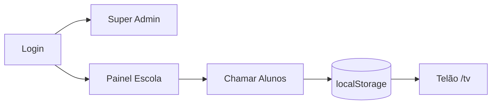

# Histórico de Diretrizes e Contexto Inicial de IA (Fase Concepção — Junho a Setembro 2026)

**Data de Consolidação:** 24/10/2026 (Ciclo I — Higiene Documental)  
**Autoridade:** MyHub / AADS  
**Status:** HISTÓRICO CONSOLIDADO — Preservação de contexto embrionário  
**Nota de Governança:** Este documento consolida integralmente o conteúdo histórico dos 4 arquivos embrionários da raiz `ai/` (`ai-context.md`, `coding-rules.md`, `forbidden-actions.md` e `project-summary.md`), cujas diretrizes foram refinadas e superadas pela governança atual em `AGENTS.md`, `GEMINI.md` e `.agents/rules/`.

---

## Parte 1: AI Context Original (`ai/ai-context.md`)

> Resumo executivo elaborado para as primeiras ferramentas de IA (junho/julho 2026).

### O que é
**Smart Exit School** é um SaaS frontend para escolas gerenciarem a **saída de alunos** no fim do expediente. Desenvolvido pela **AllTech Solutions**, permite cadastrar turmas/alunos, chamar alunos para portões específicos e exibir chamadas em um **telão (TV)**.

**Estado naquele momento:** SPA React com **DAL (services)** — persistência majoritária em **localStorage**, schema **PostgreSQL (Supabase)** parcialmente implementado e integração incremental em andamento.

### Como funcionava

1. **Super Admin** (`admin@alltech.com`) gerencia escolas e planos em `/admin/institutions`
2. **Escola** faz login → `/painel` com abas: Monitor, Alunos, Turmas, Portões, Import, Relatórios, Fleet, Config
3. **Operador** chama aluno no Monitor → fila persistida em `@SmartExit:called:{schoolId}`
4. **Telão** (`/tv`) lê a fila via `storage` event + polling 2s

### Tecnologias do Baseline
| Camada | Stack |
|--------|-------|
| UI | React 19, JSX |
| Build | Vite 8 |
| Roteamento | React Router DOM 7 |
| CSS | Tailwind CSS 4 |
| Ícones | Lucide React |
| Dados runtime | localStorage via `storageClient` |
| Dados persistentes | PostgreSQL via Supabase |
| Migrations iniciais | `supabase/migrations/` (0001–0004) |

### Regras Críticas Originais
- **Autenticação:** Admin hardcoded em `Login.jsx`; Escola com `authService.login()` lendo catálogo via `schoolService.getAllSchools()`; sessão `@SmartExit:loggedSchool`.
- **Planos SaaS:** Basic (operação core), Premium (+ whitelabel, dark mode), Diamond (+ API mock, fleet).
- **Fluxo de Chamada:** Prevenção de duplicidade por aluno na fila; portão persistido ou `defaultExit` textual; confirmação de saída removendo da fila sem histórico.
- **Armadilhas conhecidas:** `defaultExit` textual no cache; senhas em plaintext; ausência de guard em `/admin`.

---

## Parte 2: Coding Rules Originais (`ai/coding-rules.md`)

Regras derivadas dos padrões identificados no código existente na fase inicial:

### Linguagem e Arquivos
- JavaScript (ES Modules) — sem TypeScript.
- Extensões: `.jsx` para componentes React, `.js` para utilitários/serviços.
- Comentários em português; UI em português (BR).

### Padrão Monolítico de InstitutionPanel
Estrutura de comentários que organizava o arquivo de 1300 linhas:
```javascript
// SEÇÃO 1: REFS E NAVEGAÇÃO
// SEÇÃO 2: ESTADOS GLOBAIS
// SEÇÃO 3: ESTADOS DAS FUNCIONALIDADES
// SEÇÃO 4: useEffect
// SEÇÃO 5: EARLY RETURN (if (!school) return null)
// SEÇÃO 6: HANDLERS
// SEÇÃO 7: ESTILOS CALCULADOS
// SEÇÃO 8: RENDER JSX
```
*Regra crítica:* Todos hooks (`useState`, `useEffect`, `useRef`) estritamente antes do primeiro `return` condicional.

### Estilização e Temas
- Tailwind CSS 4 utility classes (sem CSS modules).
- CSS variables para paleta dinâmica: `--color-primary` (`#f97316`), `--color-secondary` (`#3b82f6`).
- Dark mode com classe `.dark` em `document.documentElement`.
- Ícones nomeados via `lucide-react`.

### Estado e Persistência
- Prefixo obrigatório em chaves de storage: `@SmartExit:`.
- IDs gerados via `Date.now()`.
- Sem bibliotecas de estado global pesadas (Redux/Zustand); uso de estado local `useState`.

---

## Parte 3: Forbidden Actions Originais (`ai/forbidden-actions.md`)

Catálogo de ações proibidas estabelecido para guiar agentes autônomos nas fases iniciais:

| # | Ação Proibida | Motivo / Justificativa |
|---|---------------|------------------------|
| 1 | Inventar backend ou banco não documentado | Seguir schema Supabase, ADRs e migrations oficiais |
| 2 | Assumir integrações externas não identificadas | Manter escopo real do código |
| 3 | Documentar funcionalidades não presentes no código | Fidelidade estrita ao código |
| 4 | Instalar dependências sem necessidade clara | Preservar bundle enxuto |
| 5 | Migrar para TypeScript sem solicitação | Projeto padronizado em JavaScript JSX |
| 6 | Criar commits ou push sem pedido explícito | Precedência de governança e aprovação humana |
| 7 | Alterar layouts/visual sem solicitação | Preservar identidade visual AllTech |
| 8 | Modificar paleta de cores default (`#f97316`, `#3b82f6`) | Cores institucionais de marca |
| 9 | Remover dark mode ou whitelabel | Features vinculadas aos planos pagos |
| 10 | Alterar copy/textos de upgrade de planos | Decisão comercial/marketing |
| 11 | Redesenhar telão `/tv` sem solicitação | Interface operacional de alta criticidade |
| 12 | Modificar sidebar/abas do `InstitutionPanel` | Estabilidade da navegação do usuário |
| 13 | Alterar fluxo de chamada de alunos | Core business do produto |
| 14 | Modificar matriz de permissões por plano | Modelo de negócio SaaS |
| 15 | Remover verificação anti-duplicata na fila | Integridade do pátio escolar |
| 16 | Unificar `exits` e `gatesList` sem plano | Risco de breaking changes no runtime |
| 17 | Alterar credenciais mock/admin sem aviso | Suporte aos ambientes de teste |
| 18 | Modificar schema localStorage sem migração | Quebra de retrocompatibilidade com dados locais |
| 19 | Renomear chaves `@SmartExit:*` | Dessincronização entre abas de telão e painel |
| 20 | Usar chaves legadas `institutions`/`currentUser` | Padrões obsoletos do protótipo inicial |
| 21 | Adicionar IndexedDB/SQL.js | Mudança estrutural desnecessária |
| 22 | Executar `localStorage.clear()` indiscriminadamente | Perda de dados operacionais locais |
| 23 | Reativar componentes órfãos (`StudentCard`, `students.js`) | Código morto sem uso |
| 24 | Importar `App.css` | Boilerplate inicial gerado pelo Vite |
| 25 | Adicionar hooks após early return | Quebra das Rules of Hooks do React |
| 26 | Criar abstrações prematuras e over-engineering | Princípio YAGNI |
| 27 | Commitar senhas reais ou segredos de infra | Segurança e governança |
| 28 | Expor credenciais admin em documentação de produção | `admin123` restrito a desenvolvimento local |
| 29 | Implementar hash de senha client-side sem backend | Falsa sensação de segurança |
| 30 | Desabilitar regras ESLint de React Hooks | Proteção de integridade da UI |
| 31 | Adicionar bibliotecas UI externas (MUI, Chakra) | Padronização em Tailwind CSS 4 |
| 32 | Substituir `lucide-react` por outra biblioteca de ícones | Consistência visual do design system |
| 33 | Criar arquivos markdown redundantes ou não solicitados | Higiene e governança documental |

---

## Parte 4: Project Summary Original (`ai/project-summary.md`)

Resumo executivo do projeto registrado em 24/09/2026:

### One-liner
SaaS frontend para gestão de saída escolar. Identidade no Supabase Auth; tenant via membership ativa em `school_members`. Cache operacional em localStorage. Frontend publicado na Vercel; migrations aplicadas no Supabase de produção. Primeira instituição de homologação: Colégio Adventista de Esteio.

### Rotas e Perfis
- `/login`: Autenticação.
- `/admin/institutions`: Gestão de plataforma (`is_platform_admin()`).
- `/painel`: Painel institucional da escola (`school_members` ativo).
- `/tv`: Telão operacional para alunos e pátio.

### Papéis de Usuário
1. **Platform Admin:** avaliado via RPC `is_platform_admin()`.
2. **Usuário de Escola:** membership ativa vinculada à instituição.
3. **Telão TV:** sessão anônima consumindo eventos de fila.

### Estado da Persistência na Transição
- Identidade no Supabase Auth com logout encerrando sessão.
- Isolamento multi-tenant garantido por Row Level Security (RLS) no PostgreSQL.
- LocalStorage mantido exclusivamente para comunicação rápida entre abas e cache de UI.
