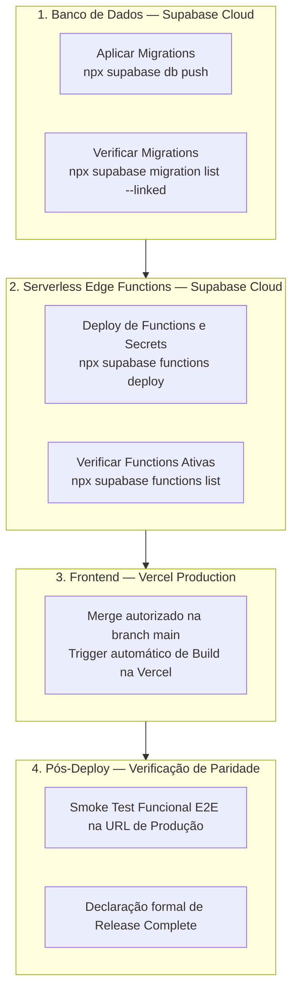

# Regra de Deploy Parity — Smart Exit School

**Data de Registro:** 11/10/2026  
**Autoridade:** MyHub / AADS  
**Status:** Ativa / Compulsória  
**Classificação:** Regra Operacional Permanente (Fonte Única da Verdade)  

---

## 1. Princípio Fundamental

> **REGRA DE DEPLOY PARITY:**  
> Nenhuma entrega em produção é considerada concluída se frontend, banco de dados (migrations) e Edge Functions não estiverem todos implantados, em conjunto e funcionais no ambiente de produção.

É expressamente proibido considerar concluída uma entrega em produção quando o frontend está no ar mas a camada de banco de dados ou Edge Functions correspondente não foi aplicada no ambiente de produção. O sistema deve atingir paridade de estado completa em cada ciclo de release.

---

## 2. Escopo de Aplicação

Esta regra aplica-se obrigatoriamente a toda e qualquer alteração promovida para o ambiente de produção do Smart Exit School, englobando:
- Novas funcionalidades (*features*) que dependam de schema, RPCs ou Edge Functions;
- Correções de defeitos (*bug fixes* ou *hotfixes*);
- Migrações de banco de dados (`supabase/migrations/*.sql`);
- Criação ou modificação de Serverless Edge Functions (`supabase/functions/*`);
- Alterações em políticas de segurança e Row Level Security (RLS);
- Ajustes em secrets ou variáveis de ambiente de produção.

---

## 3. Ordem Canônica de Deploy em Produção (Obrigatória)

Para garantir que a camada de apresentação (frontend) nunca consuma um backend inexistente ou desatualizado em produção, os deploys devem seguir rigorosamente a sequência **Backend First**:



### Passo 1: Banco de Dados (Supabase Cloud)
1. Vincular o projeto ao Supabase Cloud caso ainda não vinculado:
   ```bash
   npx supabase link --project-ref yantfnekslrzhussewdh
   ```
2. Aplicar as migrações pendentes:
   ```bash
   npx supabase db push
   ```
3. Confirmar que não há migrações locais pendentes no ambiente remoto:
   ```bash
   npx supabase migration list --linked
   ```

### Passo 2: Serverless Edge Functions (Supabase Cloud)
1. Publicar todas as funções novas ou modificadas:
   ```bash
   npx supabase functions deploy impersonate-user
   npx supabase functions deploy end-impersonation
   ```
2. Garantir que os secrets de produção estejam configurados (`SUPABASE_JWT_SECRET`, etc.):
   ```bash
   npx supabase secrets list
   ```
3. Validar que as funções estão disponíveis e ativas no painel ou CLI:
   ```bash
   npx supabase functions list
   ```

### Passo 3: Frontend (Vercel)
1. Somente após os Passos 1 e 2 estarem comprovadamente concluídos no Supabase Cloud, realizar a integração Git autorizada via Decision Gate (`G-MERGE`) na branch `main`.
2. Acompanhar a compilação do bundle de produção na Vercel até o status `Ready`.

### Passo 4: Verificação de Paridade e Smoke Test
1. Realizar verificação na aplicação de produção (`https://smart-exit-school.vercel.app`).
2. Executar teste de fumaça mínimo do fluxo alterado (ex.: abertura de modais, consultas de catálogo, acionamento de chamadas conforme [docs/qa-production-smoke.md](qa-production-smoke.md)).
3. Verificar a ausência absoluta de erros de schema cache do PostgREST (`PGRST202`), falhas de rota ou 503 em funções.

---

## 4. Proibição Explícita de Deploy Invertido

É terminantemente proibido:
1. Realizar merge na branch `main` ou deploy direto para a Vercel antes de confirmar que o banco de dados e as Edge Functions já foram aplicados e estão operacionais em produção.
2. Inverter a ordem executando deploy de frontend com a promessa de aplicar migrations ou Edge Functions a posteriori.
3. Declarar uma tarefa como concluída em produção quando apenas o frontend foi promovido.

> **Impacto da Violação:**  
> A inversão da ordem faz com que navegadores de usuários finais recebam código novo chamando RPCs, tabelas ou endpoints que ainda não existem no PostgREST de produção, gerando erros críticos como:  
> `Could not find the function public.<nome_da_funcao>(...) in the schema cache (PGRST202)`.

---

## 5. Evidências Obrigatórias para Declarar "Release Complete"

Sob o Completion Model do AADS (`ai/aads/engine/aads-operating-model.md`), o estado **Release Complete** só pode ser reivindicado pelo agente ou equipe após a apresentação e arquivamento das seguintes evidências:

| Camada | Verificação / Comando | Evidência Requerida |
|---|---|---|
| **Banco de Dados** | `npx supabase migration list --linked` | Nenhuma migração com status pendente (`Pending`). |
| **Edge Functions** | `npx supabase functions list` | Todas as funções de `supabase/functions/` presentes e ativas no remoto. |
| **Frontend** | URL de Produção Vercel | Status de deploy `Ready` na Vercel e commit correspondente da `main`. |
| **Operacional** | Smoke Test em Produção | Ausência de erros `PGRST202` ou falhas de console em rotas impactadas. |

Se qualquer uma das evidências acima estiver pendente, o estado deve permanecer declarado como:  
`Delivery Complete. Release pending: <camadas pendentes>`.

---

## 6. Registro Histórico do Incidente (Lição Aprendida)

* **Data do Incidente:** 11/10/2026  
* **Contexto:** Promoção da Fase 3 de Impersonation (PRs #69 a #73) para o ambiente de produção.  
* **Sintoma:** Ao acessar o Painel Super Admin (`/admin/institutions`) na aba "Catálogo de Usuários & Suporte", a interface exibia o erro:  
  `Could not find the function public.list_platform_users(p_limit, p_offset, p_school_id, p_search) in the schema cache`  
  e a lista de usuários permanecia vazia, impedindo o uso da funcionalidade de suporte.  
* **Causa Raiz:** O deploy do frontend foi acionado automaticamente pelo merge na branch `main`, porém a migration `20261010140000_create_impersonation_foundation.sql` e as Edge Functions `impersonate-user` e `end-impersonation` nunca haviam sido aplicadas na instância de produção do Supabase Cloud. A documentação preexistente em `docs/deploy.md` continha instrução com ordem invertida, indicando merge primeiro e aplicação de banco depois.  
* **Prevenção Definitiva:** Instituição compulsória desta Regra de Deploy Parity e implementação de gate duro programático via hook `PreToolUse` do Antigravity (`scripts/check-deploy-parity.cjs`), que bloqueia comandos de deploy e push para `main` caso migrations ou functions estejam pendentes no Supabase Cloud.

---

## 7. Estado Atual de Paridade Verificado (Pós-Fix JWT Impersonation)

* **Data da Verificação:** 24/10/2026
* **Projeto Remoto:** `yantfnekslrzhussewdh` (Smart Exit School — `sa-east-1`)
* **Status de Migrations:** **27/27 sincronizadas** (`local == remote`), 0 pendentes, 0 local-only.
* **Status das Edge Functions:**
  * `impersonate-user`: Versão 6 `ACTIVE` (com `verify_jwt: false` e secret `JWT_SECRET` alinhada).
  * `end-impersonation`: Versão 5 `ACTIVE` (com `verify_jwt: false`).
  * `invite-member`: Versão 3 `ACTIVE`.
  * `accept-invite`: Versão 3 `ACTIVE`.
* **Secrets de Produção Obrigatórias:**
  * `JWT_SECRET`: Configurada no Supabase Cloud (garante assinatura simétrica HS256 alinhada ao GoTrue de produção).
  * `BREVO_*`: Configurado para envio de e-mails transacionais de convite.
* **Procedimento de Rollback:** Em caso de anomalia, siga estritamente o [Runbook: Rollback de Impersonation](runbooks/rollback-impersonation.md).

